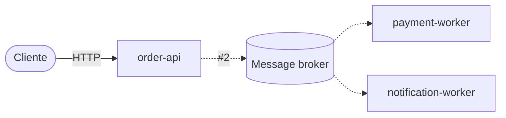

<!-- translation-of: README.md sha:9ead26548c520435de6179e0c895512f7665ceb3 (update with: scripts/translations.sh sync) -->
# distributed-systems-lab

[English](README.md) | [Português](README.pt-BR.md) | **Español**

[](https://github.com/VitorDaSilvaOliveira/distributed-systems-lab/actions/workflows/ci.yml)
[](LICENSE)


Laboratorio práctico de conceptos avanzados de backend y DevOps, construido un concepto a la vez sobre una pequeña plataforma de pedidos.
Cada paso se documenta en un [Architecture Decision Record](docs/adr/) (registro de decisión de arquitectura) y se explica en una publicación de LinkedIn de la serie **"Do conceito à prática"** (en portugués: "Del concepto a la práctica").

> La versión en inglés es la referencia. Los ADR y las guías de contribución están en inglés.

## Arquitectura



Las partes punteadas llegan en los próximos pasos.

## Hoja de ruta

| # | Concepto | Estado | ADR | Publicación |
| --- | --- | --- | --- | --- |
| 0 | Flujo de entrega y salvaguardas del repositorio | ✅ | [0004](docs/adr/0004-delivery-workflow.md) | — |
| 1 | Imágenes de contenedor ligeras y seguras | 🚧 | — | — |
| 2 | Colas vs. pub/sub | ⏳ | — | — |
| 3 | Idempotencia, reintentos y DLQ | ⏳ | — | — |
| 4 | Patrón outbox | ⏳ | — | — |
| 5 | Sagas y compensaciones | ⏳ | — | — |
| 6 | Observabilidad con OpenTelemetry | ⏳ | — | — |
| 7 | Resiliencia: timeouts, circuit breakers, backpressure | ⏳ | — | — |
| 8 | Kubernetes en producción | ⏳ | — | — |
| 9 | GitOps y entrega progresiva | ⏳ | — | — |
| 10 | Infraestructura como código y platform engineering | ⏳ | — | — |

## Ejecutar en local

Requisitos: Docker. (Java 25 solo si quieres ejecutarlo fuera de contenedores.)

```bash
docker compose up --build -d
curl -X POST localhost:8080/orders -H "Content-Type: application/json" -d '{"customer":"ana","amount":99.9}'
curl localhost:8080/orders
```

Compilar y probar sin Docker:

```bash
cd order-api
./mvnw verify          # compila, prueba, verifica el formato y genera la cobertura
./mvnw spotless:apply  # corrige el formato
```

## Estructura del repositorio

```
order-api/        servicio Spring Boot
k6/               pruebas de carga
scripts/          herramientas del repositorio
docs/adr/         registros de decisión de arquitectura
.github/          workflows de CI, plantillas, Dependabot
```

## Cómo contribuir

Consulta [CONTRIBUTING.md](CONTRIBUTING.md) (en inglés). Los commits siguen [Conventional Commits](https://www.conventionalcommits.org/).

## Licencia

[MIT](LICENSE)
