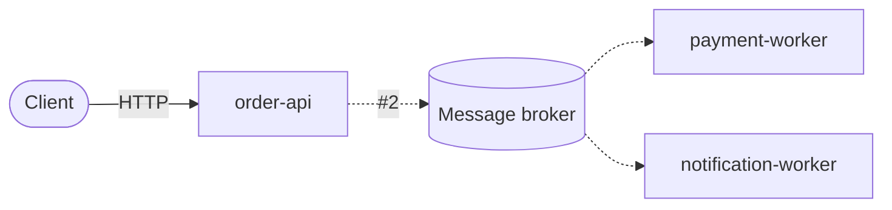

# distributed-systems-lab

**English** | [Português](README.pt-BR.md) | [Español](README.es.md)

[](https://github.com/VitorDaSilvaOliveira/distributed-systems-lab/actions/workflows/ci.yml)
[](LICENSE)


Hands-on lab of advanced backend and DevOps concepts, built one concept at a time on top of a small order platform.
Each step is documented as an [Architecture Decision Record](docs/adr/) and explained in a LinkedIn post of the series **"Do conceito à prática"**.

## Architecture



Dashed parts arrive in upcoming steps.

## Roadmap

| # | Concept | Status | ADR | Post |
| --- | --- | --- | --- | --- |
| 0 | Delivery workflow and repository guardrails | ✅ | [0004](docs/adr/0004-delivery-workflow.md) | — |
| 1 | Lean and secure container images | 🚧 | — | — |
| 2 | Queues vs. pub/sub | ⏳ | — | — |
| 3 | Idempotency, retries and DLQ | ⏳ | — | — |
| 4 | Outbox pattern | ⏳ | — | — |
| 5 | Sagas and compensations | ⏳ | — | — |
| 6 | Observability with OpenTelemetry | ⏳ | — | — |
| 7 | Resilience: timeouts, circuit breakers, backpressure | ⏳ | — | — |
| 8 | Kubernetes in production | ⏳ | — | — |
| 9 | GitOps and progressive delivery | ⏳ | — | — |
| 10 | Infrastructure as code and platform engineering | ⏳ | — | — |

## Running locally

Requirements: Docker. (Java 25 only if you want to run outside containers.)

```bash
docker compose up --build -d
curl -X POST localhost:8080/orders -H "Content-Type: application/json" -d '{"customer":"ana","amount":99.9}'
curl localhost:8080/orders
```

Build and test without Docker:

```bash
cd order-api
./mvnw verify          # compile, test, format check, coverage report
./mvnw spotless:apply  # fix formatting
```

## Repository layout

```
order-api/        Spring Boot service
k6/               load tests
scripts/          repository tooling
docs/adr/         architecture decision records
.github/          CI workflows, templates, Dependabot
```

## Contributing

See [CONTRIBUTING.md](CONTRIBUTING.md). Commits follow [Conventional Commits](https://www.conventionalcommits.org/).

## License

[MIT](LICENSE)
