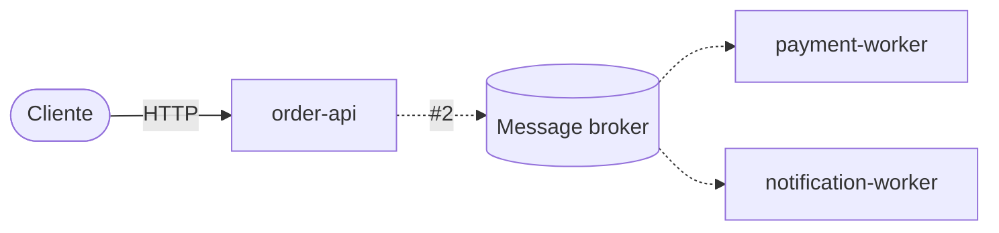

<!-- translation-of: README.md sha:9ead26548c520435de6179e0c895512f7665ceb3 (update with: scripts/translations.sh sync) -->
# distributed-systems-lab

[English](README.md) | **Português** | [Español](README.es.md)

[](https://github.com/VitorDaSilvaOliveira/distributed-systems-lab/actions/workflows/ci.yml)
[](LICENSE)


Laboratório prático de conceitos avançados de backend e DevOps, construído um conceito por vez sobre uma pequena plataforma de pedidos.
Cada passo é documentado em um [Architecture Decision Record](docs/adr/) (registro de decisão de arquitetura) e explicado em um post no LinkedIn da série **"Do conceito à prática"**.

> A versão em inglês é a referência. Os ADRs e os guias de contribuição estão em inglês.

## Arquitetura



As partes tracejadas chegam nos próximos passos.

## Roadmap

| # | Conceito | Status | ADR | Post |
| --- | --- | --- | --- | --- |
| 0 | Fluxo de entrega e guardrails do repositório | ✅ | [0004](docs/adr/0004-delivery-workflow.md) | — |
| 1 | Imagens de container enxutas e seguras | 🚧 | — | — |
| 2 | Filas vs. pub/sub | ⏳ | — | — |
| 3 | Idempotência, retries e DLQ | ⏳ | — | — |
| 4 | Outbox pattern | ⏳ | — | — |
| 5 | Sagas e compensações | ⏳ | — | — |
| 6 | Observabilidade com OpenTelemetry | ⏳ | — | — |
| 7 | Resiliência: timeouts, circuit breakers, backpressure | ⏳ | — | — |
| 8 | Kubernetes em produção | ⏳ | — | — |
| 9 | GitOps e entrega progressiva | ⏳ | — | — |
| 10 | Infraestrutura como código e platform engineering | ⏳ | — | — |

## Como rodar localmente

Requisitos: Docker. (Java 25 só se quiser rodar fora de containers.)

```bash
docker compose up --build -d
curl -X POST localhost:8080/orders -H "Content-Type: application/json" -d '{"customer":"ana","amount":99.9}'
curl localhost:8080/orders
```

Build e testes sem Docker:

```bash
cd order-api
./mvnw verify          # compila, testa, verifica formatação e gera cobertura
./mvnw spotless:apply  # corrige a formatação
```

## Estrutura do repositório

```
order-api/        serviço Spring Boot
k6/               testes de carga
scripts/          ferramentas do repositório
docs/adr/         registros de decisão de arquitetura
.github/          workflows de CI, templates, Dependabot
```

## Como contribuir

Veja o [CONTRIBUTING.md](CONTRIBUTING.md) (em inglês). Os commits seguem o [Conventional Commits](https://www.conventionalcommits.org/).

## Licença

[MIT](LICENSE)
